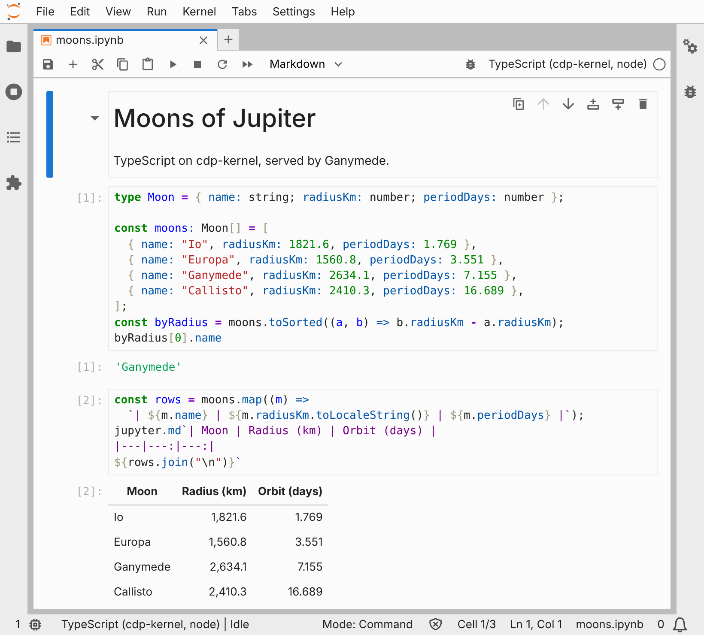

# Ganymede

[](https://github.com/tlockney/ganymede/actions/workflows/ci.yml)
[](https://github.com/tlockney/ganymede/releases/latest)
[](LICENSE)

A Jupyter server in Rust, with no Python runtime and no Python dependency.
Ganymede launches kernels from installed kernelspecs, speaks the Jupyter
messaging protocol to them, reads and writes notebooks, and serves the
same REST and websocket API as `jupyter_server`, so JupyterLab and VS Code
connect to it unchanged. The first target kernel is
[cdp-kernel](https://cdp-kernel.org), for TypeScript notebooks; any other
kernel, Python's included, works once its kernelspec is installed.

Named for Jupiter's largest moon, and for the cupbearer who served the
gods on Olympus.

**Documentation:** [ganymede-server.com](https://ganymede-server.com/)
(sources in [`docs/`](docs/)). Start with
[Install](docs/install.md), step by step from a clean
machine with no Python or Jupyter, then
[Getting started](docs/getting-started.md) and
[Architecture](docs/architecture.md).



## Features

- The `jupyter_server` REST and websocket API, so JupyterLab and VS Code
  connect unchanged. `ganymede lab` serves JupyterLab itself.
- Any installed kernel: cdp-kernel for TypeScript, ipykernel, or any other
  kernelspec. The host has no language-specific code.
- `ganymede run` and `ganymede execute` for scripts and CI, with output
  matching `jupyter execute`.
- Notebook saves that match Python's `nbformat` byte for byte, atomic
  writes, and checkpoints outside the notebook folder.
- One binary with a random token, loopback-only by default; see
  [Security](docs/security.md).
- `ganymede-engine`, a library for embedding, which builds for iOS,
  Android, and wasm.

## Quick start

```sh
curl -fsSL https://ganymede-server.com/install.sh | sh   # ganymede, plus cdp-kernel if Node 24+ is there
ganymede lab install                                     # JupyterLab's frontend, from PyPI, without Python
ganymede lab                                             # opens JupyterLab in the browser
```

## Install

Prebuilt binaries for Linux (x86_64, aarch64), macOS (Apple silicon,
Intel), and Windows (x86_64) are on the
[releases page](https://github.com/tlockney/ganymede/releases). On Linux or
macOS, this script downloads the latest release, checks its SHA-256,
installs `ganymede` into `~/.local/bin`, and, if Node 24 or later is
installed, installs [cdp-kernel](https://cdp-kernel.org) for TypeScript
notebooks:

```sh
curl -fsSL https://ganymede-server.com/install.sh | sh
```

Pass options after `sh -s --`: `--version 0.1.0` pins a release,
`--bin-dir DIR` installs elsewhere, `--no-kernel` skips cdp-kernel.
[Install](docs/install.md) walks through it, the kernel, and JupyterLab
step by step, and has the same steps done by hand and the platform notes
(glibc 2.35 or newer on Linux; unnotarized macOS binaries).

Quick test, no kernel or Python needed (`fake` is a built-in kernel):

```sh
ganymede --version                 # ganymede 0.1.0
ganymede info                      # versions and every directory in use
ganymede run -k fake 'hello'       # prints "echo: hello" and "HELLO"
ganymede serve --port 8888 --token test &
curl -H 'Authorization: token test' http://127.0.0.1:8888/api/status
kill %1
```

With a real kernel installed, for example cdp-kernel on Node or ipykernel:

```sh
npm install -g @tlockney/cdp-kernel && cdp-kernel install --runtime node
ganymede kernelspec list
ganymede run -k cdp-node 'const x = 2; x * 21'
```

Or build from source with `cargo install --path crates/ganymede-cli`.
[Install](docs/install.md) has more on both.

## Use

```
ganymede kernelspec list
ganymede run -k cdp-node 'const x = 2; x * 21'   # any installed kernelspec
ganymede run -k python3 -f script.py --json      # one JSON line per cell
ganymede console -k cdp-node                     # completion, multiline, Ctrl-C interrupts
ganymede execute notebook.ipynb -o out.ipynb     # like `jupyter execute`; --inplace, -o -
ganymede trust notebook.ipynb                    # like `jupyter trust`; shares Jupyter's signatures
ganymede kernel -k python3                       # standalone kernel; prints its connection file
ganymede run --existing kernel-....json 'x'      # reuse it
ganymede serve --root-dir . --port 8888          # point VS Code or JupyterLab at the URL
ganymede lab install                             # JupyterLab's frontend, from PyPI, no Python
ganymede lab                                     # ... then JupyterLab here, opened in the browser
ganymede serve                                   # or the same server, without the browser, at /lab
ganymede lab extension install <package>         # a prebuilt extension from its PyPI wheel
ganymede serve --static-dir <prefix>/share/jupyter/lab/static   # or one installed elsewhere
```

`-k fake` is a built-in in-process kernel for trying things out without
installing one.

To embed it, use `ganymede-engine`:

```rust
let engine = ganymede_engine::Engine::new();
let kernel = engine.start("cdp-node").await?;
let result = kernel.execute("1 + 1").await?;
println!("{}", result.text());
```

## Status

Early software. The protocol, kernel host, nbformat, executor, contents,
API, and server pass their tests, and an end-to-end suite compares
Ganymede against `jupyter execute` and `jupyter server` on cdp-kernel and
ipykernel. The VS Code Jupyter extension's remote-server flow passes, and
JupyterLab's own bundle, served at `/lab`, runs notebooks in a browser. The
engine builds for iOS, Android, and wasm. See the
[roadmap](docs/roadmap.md) and [known gaps](docs/known-gaps.md).

"No Python" means no Python runtime and no Python dependency. Python shows
up in three places, none of them a dependency: `ganymede lab install`
unpacks JupyterLab's JavaScript from its PyPI wheel without running
Python; CI runs `jupyter execute`, `jupyter server`, and ipykernel as the
reference Ganymede is compared against; and the notebook writer matches
the bytes Python's `nbformat` writes, so files don't churn in git.

Only the core is Rust. UIs are clients of its API and live outside it:
existing Jupyter frontends, a TypeScript web UI, or a native shell such as
a Swift app with a web view. JupyterLab server extensions and `jupyter_server` extensions
are not supported, by design.

## Repository

Cargo workspace at this directory. `docs/` and `site/` are the website, and
`validation/` holds scripts that drive real JupyterLab and VS Code clients.
Ganymede's own UI, and the shared TypeScript protocol package that used to
be `frontend/` here, live in
[tlockney/ganymede-ui](https://github.com/tlockney/ganymede-ui).

| Crate | What it is |
|---|---|
| [`crates/ganymede-protocol`](crates/ganymede-protocol/) | Message envelope, typed content with unknown-field passthrough, ZMQ wire framing with HMAC, connection file, websocket v1 and legacy codecs. No I/O. |
| [`crates/ganymede-nbformat`](crates/ganymede-nbformat/) | nbformat 4.5 reader as lenient as Python's, with its validation report, and a writer byte-identical to Python `nbformat.write`. |
| [`crates/ganymede-kernel-host`](crates/ganymede-kernel-host/) | Kernelspec discovery, transport seam (ZMQ and in-process), subprocess and attach provisioners, the session state machine, a fake kernel. |
| [`crates/ganymede-exec`](crates/ganymede-exec/) | Notebook executor with nbclient's semantics: outputs, `clear_output(wait)`, `display_id` across cells, `language_info`, timings, widget state, allowed errors and tags, timeouts. |
| [`crates/ganymede-engine`](crates/ganymede-engine/) | The library to embed. `Engine` finds kernelspecs and starts, attaches, or adopts kernels; `Kernel` executes with streaming output and stdin, completes, inspects, interrupts, restarts, runs notebooks. Features `zmq` and `subprocess` (default) drop out for wasm. |
| [`crates/ganymede-cli`](crates/ganymede-cli/) | The `ganymede` command: `kernelspec list/paths/install/remove`, `run`, `console`, `execute`, `kernel`, `nb clear`, `trust`, `lab`, `lab install/list/remove`, `lab extension install/list/remove`, `serve`, `info`. |
| [`crates/ganymede-contents`](crates/ganymede-contents/) | Contents seam and filesystem implementation matching `jupyter_server`'s model: atomic writes, mtime conflicts, checkpoints, configurable checkpoint dir, path safety, notebook trust with Jupyter's signing key and `nbsignatures.db`. |
| [`crates/ganymede-api`](crates/ganymede-api/) | Kernel and session managers, response models, per-client bridge with reply filtering, idle culling. No HTTP. |
| [`crates/ganymede-server`](crates/ganymede-server/) | axum routes, token auth, origin check, websocket v1 and legacy framing, static assets, TOML config, JupyterLab's page and `/lab/api/*`, installed JupyterLab bundles, notebook trust. |

## Testing

`cargo test --workspace` runs everything with the in-process fake kernel.
The e2e tests in `crates/ganymede-cli/tests/` also use whatever real
kernels and Jupyter are installed, and skip what is missing:

| Variable | Effect |
|---|---|
| `GANYMEDE_E2E_KERNELS=cdp-node,python3` | These kernels must exist; their tests fail instead of skipping. |
| `GANYMEDE_E2E_JUPYTER=/path/to/jupyter` | The reference `jupyter` (needs `nbclient` and `jupyter_server`). Defaults to `PATH`. |
| `GANYMEDE_E2E_REQUIRE_JUPYTER=1` | Fail instead of skipping when it is missing. |
| `E2E_DUMP=1` | Print both server transcripts. |
| `GANYMEDE_E2E_LAB=1` | Run `lab.rs`, which downloads JupyterLab and the widget extensions from PyPI (about 18 MB). |

- `kernels.rs`: the same scenarios on every kernel, through the engine and
  the CLI: kernel_info passthrough, results, streams, errors, stdin,
  interrupt, restart, comms, completion, inspection, standalone kernels.
- `parity.rs`: each notebook in [`e2e/notebooks/`](e2e/notebooks/) is
  executed by `jupyter execute` and by `ganymede execute`, and the files
  are compared after normalizing timestamps and ids. Mismatches are kept
  under `$TMPDIR/ganymede-parity-*`. Also checks that `ganymede trust` and
  `jupyter trust` share one signature store.
- `server.rs`: one REST and websocket scenario against `jupyter server`
  and `ganymede serve`, compared as transcripts, including which cells come
  back `trusted` after each kind of save and after `POST .../trust`.
- `lab.rs`: `ganymede lab install` from PyPI, then `ganymede serve`
  answering `/lab` and `/lab/api/settings` from the installed bundle and
  the default widget extensions.
- `lab_start.rs`: `ganymede lab --no-browser` on a stand-in bundle,
  offline: the port fallback, and the printed URL logging in at `/lab`.
- [`e2e/wasm-smoke/`](e2e/wasm-smoke/): the engine built for
  `wasm32-wasip1`, running a notebook on the fake kernel under Node's WASI.

CI runs the e2e job on Linux and macOS with Node 24, cdp-kernel 0.6.0,
and ipykernel, plus a portability job for iOS, Android, and wasm. Its
`workstation` job follows [Install](docs/install.md) on Linux and macOS
with Python hidden from `PATH`
([`scripts/test-workstation.sh`](scripts/test-workstation.sh)): the PR's
binary through `install.sh`, cdp-kernel from npm, `ganymede lab install`,
`ganymede lab` driven by Playwright, `ganymede execute`, `ganymede serve`
with the VS Code extension's requests, and the uninstall, failing if any
Python ran.

## Contributing

Work is tracked in [GitHub issues](https://github.com/tlockney/ganymede/issues):
each task and each bug found gets an issue before work starts, and every
pull request links the issue it resolves (`Closes #N`), which CI checks,
and adds what it learned to the [development log](docs/notes.md) as a new
file in [`docs/notes/`](docs/notes/), so open PRs don't conflict there. The
[Development](docs/development.md) page has the rules and how to build the
docs.

Releases go through a PR like any other change.
[`scripts/release.sh`](scripts/release.sh), run from an up-to-date `main`,
wraps [cargo-release](https://github.com/crate-ci/cargo-release) and
[git-cliff](https://git-cliff.org)
(`cargo install --locked cargo-release git-cliff`):

```sh
scripts/release.sh minor            # dry run: version bump and changelog preview
scripts/release.sh minor --execute  # commit on release/vX.Y.Z, push, open issue + PR
```

The level is `patch`, `minor`, `major`, or an explicit version such as
`0.2.0-rc.1`. All crates share the workspace version, so the tag, the
crates, and `ganymede --version` agree. [`CHANGELOG.md`](CHANGELOG.md)
lists the pull requests merged into each release, from the merge commits.
Merging the release PR runs
[`tag-release.yml`](.github/workflows/tag-release.yml), which tags the merge
commit `vX.Y.Z` and starts [`release.yml`](.github/workflows/release.yml).
That builds the five targets above, checks each binary reports the
tagged version (x86_64 macOS under Rosetta), and publishes a GitHub Release with
`ganymede-X.Y.Z-<target>.tar.gz` (`.zip` on Windows; each holds the binary,
`README.md`, `LICENSE`, and `THIRD-PARTY-NOTICES`), a `.sha256` per
archive, `SHA256SUMS`, a build provenance attestation per archive, and
that version's changelog section as notes.
Versions with a `-` suffix are marked prerelease. Pushing a `v*` tag by hand
also starts `release.yml`. When a release fails partway,
[Releasing](docs/releasing.md) has the recovery steps.

## License

MIT; see [LICENSE](LICENSE). Every dependency linked into the binary is
under a permissive license; `about.toml` lists the accepted ones, CI fails on
any other, and each release archive carries `THIRD-PARTY-NOTICES` generated
by [`cargo about`](https://github.com/EmbarkStudios/cargo-about).
