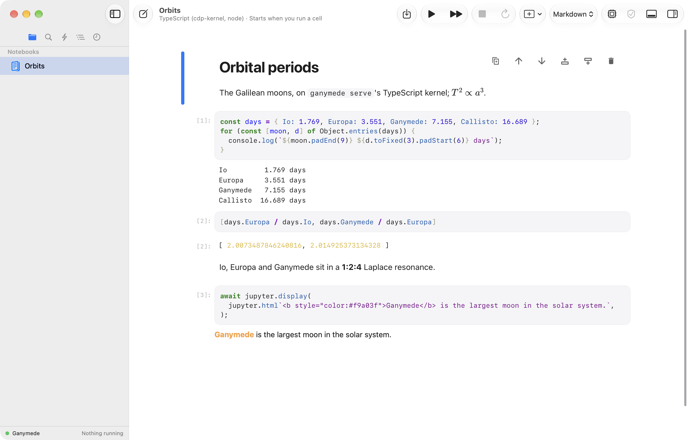

# Ganymede

[](https://github.com/tlockney/ganymede/actions/workflows/ci.yml)
[](https://github.com/tlockney/ganymede/releases/latest)
[](LICENSE)

A notebook runtime with a Rust core, and the Mac, iPad and iPhone
[apps](docs/app.md) built on it. The apps run the server inside the app;
the same core is a command-line server and a library to embed.

- **Notebooks as programs.** A notebook takes parameters and returns
  named results, so it runs from the command line, CI, HTTP, a
  `ganymede://` link or Shortcut on the Mac, or another notebook
  ([Notebooks as programs](docs/programs.md)).
- **An agent and a person in one notebook.** `ganymede mcp` lets Claude
  Code or another MCP client work in a notebook as it goes, so the
  notebook it leaves reruns from the top ([Agents](docs/agent-journals.md)).
- **TypeScript notebooks** on [cdp-kernel](https://cdp-kernel.org), on
  Node, Deno, or inside the iPad and iPhone apps.
- **Works with Jupyter.** Ganymede serves the same REST and websocket API
  as `jupyter_server` and launches kernels from installed kernelspecs, so
  JupyterLab, VS Code and ipykernel work with it unchanged. The server
  itself needs no Python.

Named for Jupiter's largest moon, and for the cupbearer who served the
gods on Olympus.

**Documentation:** [ganymede-server.com](https://ganymede-server.com/)
(sources in [`docs/`](docs/)). Start with
[the apps](docs/app.md), or [Install](docs/install.md) for the command
line, step by step from a clean machine with no Python or Jupyter. Worked
notebooks are in [Examples](docs/examples.md), and
[Why Ganymede](docs/why.md) has the background.

<picture>
  <source media="(prefers-color-scheme: dark)" srcset="docs/images/apps/mac-dark.png">
  
</picture>

## Features

- Mac, iPad and iPhone apps with the server in-process
  ([ganymede-ui](docs/app.md)); the Mac app is
  [released](https://github.com/tlockney/ganymede-ui/releases/latest),
  the iPad and iPhone apps are on TestFlight.
- Parameters and named results: `ganymede execute -p NAME=VALUE
  --results`, `POST /api/notebooks/run`, and a host API through which a
  notebook runs others it has been granted ([Host API](docs/host-api.md)).
- `ganymede mcp` for agents, with `ganymede nb publish` to turn a
  notebook into a page ([Agents over MCP](docs/mcp.md)).
- The `jupyter_server` REST and websocket API, so JupyterLab and VS Code
  connect unchanged. `ganymede lab` serves JupyterLab itself.
- Any installed kernel: cdp-kernel for TypeScript, ipykernel, or any other
  kernelspec. The host has no language-specific code.
- Output matching `jupyter execute`, and notebook saves that match
  Python's `nbformat` byte for byte, with atomic writes and checkpoints
  outside the notebook folder.
- One binary with a random token, loopback-only by default; see
  [Security](docs/security.md).
- Local-first: no telemetry, notebooks stay on your machine unless you
  connect a remote gateway, and crash reporting is off unless you turn
  it on ([Privacy](docs/privacy.md)).
- `ganymede-engine`, a library for embedding, which builds for iOS,
  Android, and wasm ([Embedding](docs/embedding.md)).

## Quick start

```sh
curl -fsSL https://ganymede-server.com/install.sh | sh   # ganymede, plus cdp-kernel if Node 22.18+ is there
ganymede lab install                                     # JupyterLab's frontend, from PyPI, without Python
ganymede lab                                             # opens JupyterLab in the browser
```

## Install

Prebuilt binaries for Linux (x86_64, aarch64), macOS (Apple silicon,
Intel), and Windows (x86_64) are on the
[releases page](https://github.com/tlockney/ganymede/releases). Linux
and macOS are tested end to end; the Windows build is untested and best
effort ([Known gaps](docs/known-gaps.md#platforms)). The
script above downloads the latest, checks its SHA-256, installs
`ganymede` into `~/.local/bin`, and installs
[cdp-kernel](https://cdp-kernel.org) if Node 22.18 or later is there. Pass
options after `sh -s --`: `--version 0.1.0` pins a release, `--bin-dir
DIR` installs elsewhere, `--no-kernel` skips cdp-kernel. To build from
source: `cargo install --path crates/ganymede-cli`.
[Install](docs/install.md) has each step by hand and the platform notes.

## Use

```
ganymede run -k fake 'hello'                     # a built-in kernel, for trying things out
ganymede run -k cdp-node 'const x = 2; x * 21'   # any installed kernelspec
ganymede console -k cdp-node                     # completion, multiline, Ctrl-C interrupts
ganymede execute notebook.ipynb -o out.ipynb     # like `jupyter execute`
ganymede trust notebook.ipynb                    # like `jupyter trust`
ganymede serve --root-dir . --port 8888          # point VS Code or JupyterLab at the URL
ganymede lab                                     # JupyterLab, opened in the browser
```

[Getting started](docs/getting-started.md) walks through these, and
[CLI and configuration](docs/reference.md) lists every command and flag.

## Status

Early software. The protocol, kernel host, nbformat, executor, contents,
API, and server pass their tests, and an end-to-end suite compares
Ganymede against `jupyter execute` and `jupyter server` on cdp-kernel and
ipykernel. The VS Code Jupyter extension's remote-server flow passes, and
JupyterLab's own bundle, served at `/lab`, runs notebooks in a browser. The
engine builds for iOS, Android, and wasm. See the
[roadmap](docs/roadmap.md) and [known gaps](docs/known-gaps.md).

The server has no Python runtime or Python dependency;
[Replacing Python](docs/python-free.md) says where Python still appears
and why, and [Switching from jupyter_server](docs/switching.md) what a
move from Jupyter's own server keeps and loses. UIs are clients of the
API and live outside the core.

## Repository

Cargo workspace at this directory. `docs/` and `site/` are the website, and
`validation/` holds scripts that drive real JupyterLab and VS Code clients.
Ganymede's own UI, and the shared TypeScript protocol package that used to
be `frontend/` here, live in
[tlockney/ganymede-ui](https://github.com/tlockney/ganymede-ui).

The crates, and how they depend on each other, are on the
[Architecture](docs/architecture.md#inside-ganymede) page.

## Contributing

Work is tracked in [GitHub issues](https://github.com/tlockney/ganymede/issues):
each task and each bug found gets an issue before work starts, and every
pull request links the issue it resolves (`Closes #N`), which CI checks,
and adds what it learned to the [development log](docs/notes.md) as a new
file in [`docs/notes/`](docs/notes/), so open PRs don't conflict there. The
[Development](docs/development.md) page has the rules and how to build the
docs.

Releases go through a pull request like any other change;
[Releasing](docs/releasing.md) has the steps.

## License

MIT; see [LICENSE](LICENSE). Every dependency linked into the binary is
under a permissive license; `about.toml` lists the accepted ones, CI fails on
any other, and each release archive carries `THIRD-PARTY-NOTICES` generated
by [`cargo about`](https://github.com/EmbarkStudios/cargo-about).
