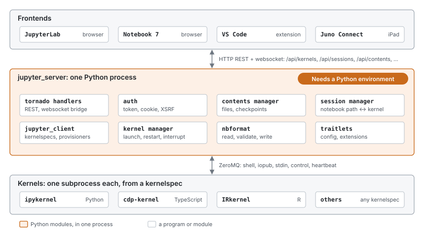
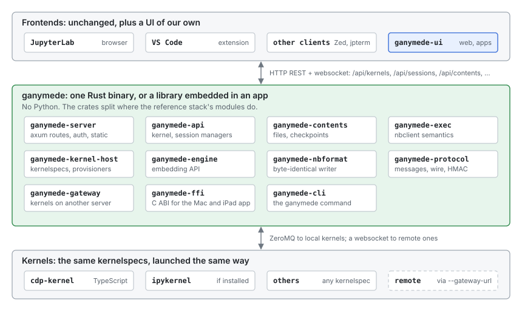

# Architecture

Ganymede replaces one part of the Jupyter stack: the server in the
middle, between the frontends people use and the kernels that run their
code. The interfaces on both sides of that server stay as they are, so
the frontends and kernels on either side don't change. This page shows the
Jupyter architecture first, then where Ganymede sits in it, then how
Ganymede is built inside.

## The Jupyter architecture

Jupyter is three layers joined by two protocols.

- **Frontends** show notebooks and send code to run: JupyterLab and
  Notebook 7 in a browser, the VS Code Jupyter extension, and other
  clients. They never talk to a kernel directly.
- **`jupyter_server`** is the process in the middle. It serves a REST API
  for kernels, sessions (which notebook uses which kernel), contents
  (files and checkpoints), and kernelspecs, and a websocket per kernel
  that carries protocol messages between frontends and the kernel. It
  handles auth, and serves the frontend's static files when the frontend
  is a web page.
- **Kernels** run code in one language. Each is a separate process,
  launched from a *kernelspec*: a `kernel.json` file in a Jupyter data
  directory that gives the command line, display name, language, and
  interrupt mode. ipykernel is the Python kernel; cdp-kernel, IRkernel,
  and many others exist.

The two protocols are what make the layers replaceable:

- Between frontend and server, **HTTP and websockets**: the
  `jupyter_server` REST API, and two websocket framings of protocol
  messages (JSON, and the binary `v1.kernel.websocket.jupyter.org`).
- Between server and kernel, the **Jupyter messaging protocol** over
  **ZeroMQ**: five sockets per kernel (shell for requests, iopub for
  outputs and status broadcast to every client, stdin for `input()`,
  control for interrupt and shutdown, heartbeat for liveness), each message
  signed with HMAC using a key from the kernel's connection file.

Inside `jupyter_server`, the work is split across Python packages:
`jupyter_client` finds kernelspecs, launches kernels, and owns their
sockets; `nbformat` reads, validates, and writes notebook files;
`traitlets` carries configuration; and server extensions plug in more
endpoints. `nbclient` (`jupyter execute`) runs notebooks headless on the
same `jupyter_client`, without the server.

Nothing in the protocols requires Python. The server is where Python comes
in: to run any notebook, even a TypeScript one, you install a Python
environment for `jupyter_server` and `jupyter_client`.

## Where Ganymede sits

Ganymede takes the middle box's place and keeps both of its interfaces:

- **Upward**, it serves the `jupyter_server` REST and websocket API, so
  JupyterLab and VS Code connect to it unchanged. That API is a
  compatibility target: where Ganymede and `jupyter_server` differ, the
  difference is a bug. UIs of Ganymede's own (a TypeScript web UI, or a
  Swift shell with a web view on iPadOS and macOS) are clients of the same
  API, outside the core.
- **Downward**, it launches kernels from the same kernelspecs in the same
  data directories, and speaks the same messaging protocol over ZeroMQ. A
  kernel can't tell Ganymede from `jupyter_server`.

What changes is everything inside the box. It is Rust, one binary or one
library, with no Python environment behind it. Python is still welcome as
a kernel: install ipykernel and its kernelspec, and Ganymede runs it like
any other.

The headless executor moves inside too. `ganymede execute` produces the
notebook `jupyter execute` would, from the same library the server is
built on.

| Jupyter | Ganymede | Notes |
|---|---|---|
| Messaging protocol, wire format | `ganymede-protocol` | Unknown content fields pass through, so kernel extras reach clients. |
| `jupyter_client` | `ganymede-kernel-host` | Kernelspecs, launch, the startup handshake, interrupt, shutdown, heartbeat. |
| `nbformat` | `ganymede-nbformat` | The writer's output is byte-identical to Python's, so saves don't produce diffs. |
| `nbclient` | `ganymede-exec` | The same outputs, `display_id` updates, timings, and error handling. |
| Contents manager | `ganymede-contents` | Atomic writes, modification-time conflict checks, checkpoints. |
| Kernel and session managers | `ganymede-api` | Independent of HTTP, so an in-app bridge can call it too. |
| tornado handlers, auth | `ganymede-server` | axum routes, token auth, origin checks, both websocket framings, JupyterLab's page and `/lab/api/*`. |
| `jupyter` CLI | `ganymede` | `kernelspec`, `run`, `console`, `execute`, `kernel`, `serve`. |
| traitlets config | TOML config file | One file plus command-line flags. |
| Server extensions | none | Not compatible by design: they are Python. |

## Inside Ganymede

The crates are layered so that each profile takes only what it needs.
Lower crates know nothing of the ones above them.

| Crate | Depends on | What it is |
|---|---|---|
| `ganymede-protocol` | none | Message types, the ZeroMQ multipart frame layout with HMAC, connection files, the websocket codecs. No I/O. |
| `ganymede-nbformat` | none | nbformat 4.5 reading and writing. No I/O. |
| `ganymede-kernel-host` | protocol | Kernelspec discovery; the `KernelTransport` seam (ZeroMQ, in-process); provisioners (subprocess, attach to a running kernel); the per-kernel session state machine. |
| `ganymede-exec` | kernel-host, nbformat | Runs a notebook with nbclient's semantics. |
| `ganymede-engine` | kernel-host, exec | The library to embed: find kernelspecs, start or attach to kernels, execute with streaming output, run notebooks. |
| `ganymede-contents` | nbformat | The contents model over a filesystem. |
| `ganymede-api` | kernel-host, contents | Kernel and session managers, response models, the per-client bridge, idle culling. No HTTP. Contents path validation confines kernel working directories to the root. |
| `ganymede-server` | api, contents, gateway | The HTTP and websocket server. |
| `ganymede-cli` | engine, server | The `ganymede` binary. |
| `ganymede-gateway` | kernel-host | Kernels on another Jupyter server, as `jupyter_server`'s gateway client: kernelspecs and lifecycle over its REST API, channels over its websocket. The server uses it for `gateway_url`. |
| `ganymede-ffi` | server | A C ABI (`include/ganymede.h`) that runs the server on loopback inside an app and returns its URL. A static library; `scripts/build-xcframework.sh` packages it for the Swift shell. |

Outside the Rust core, and outside this repository, the TypeScript for UIs
that render in a web view lives in
[tlockney/ganymede-ui](https://github.com/tlockney/ganymede-ui): its
`packages/client` has protocol types, websocket codecs, a
`ServerConnection` with injectable `fetch` and `WebSocket`, a REST client,
and renderer and widget seams. How the app itself is built, including the
Mac and iPad app around this server, is on ganymede-ui's
[architecture](ganymede-ui/architecture.md) page.

### Seams

Each seam is a trait in Rust or an interface in TypeScript. The right
column lists the implementations the [profiles](#deployment-profiles)
need, built or planned.

| Seam | What it abstracts | Implementations |
|---|---|---|
| `KernelTransport` | A stream of channel messages to and from one kernel, with channel name, header, content, buffers | ZMQ (desktop, server); in-process channel (iPad local kernel); websocket client to another host (iPad to server, or any host proxying a remote host) |
| `Provisioner` | How a kernel comes to exist | Local subprocess from a kernelspec; attach to an existing connection file or address; in-process (the app owns the kernel); remote, which proxies to another host's REST API as `jupyter_server`'s gateway client does |
| `TransportFactory` | How a launched kernel gets its `KernelTransport`, paired with its provisioner | ZMQ from the kernel's connection info (subprocess and attach); the app's own for an in-process kernel, which has no connection info (`LaunchedKernel.connection` is `None`) |
| `KernelspecSource` | Where the list of launchable kernels comes from | Jupyter data dirs on the filesystem; extra roots from config, which is how conda and venv kernels get found without the host knowing what a venv is; an environment scanner as an optional module, as VS Code has; a static embedded list for the iPad (local kernel plus configured remotes) |
| `Contents` | Files, directories, checkpoints | Local filesystem with atomic writes and mtime checks; Files app or iCloud container on iPad; passthrough to a remote host |
| `Auth` | Who may call the API | None (in-app bridge); token; `tailscale serve` identity headers; later, an OIDC or Hub contract |
| `Frontend host` | How a UI reaches the core | HTTP plus websocket (axum) on desktop and server; an in-app bridge on iPad that carries the same JSON shapes with no HTTP |
| UI (any language) | The client the user sees | Existing Jupyter frontends; a TS web UI; a Swift shell with a web view on iPad. Not a Rust module; the core only owes it the API |
| `Document` | The live notebook model | File-as-truth with reload on external change; `yrs` CRDT with y-websocket for live multi-client sessions |
| `Renderer` (TS) | One MIME type to DOM | Text, ANSI streams, HTML (sanitized or iframed), images, SVG, Markdown, LaTeX, JSON, Vega, Plotly, and a widget view |
| `WidgetManager` (TS) | The `jupyter.widget` comm target | anywidget-only, small, enough for cdp-kernel; full `@jupyter-widgets/base` plus `controls`, needed when a Python kernel with ipywidgets runs. Choose per profile, not globally |
| `Editor` (TS) | Code editing | CodeMirror 6, mode from `language_info.codemirror_mode` |

The server uses kernelspec dirs, subprocesses and ZMQ for `KernelspecSource`,
`Provisioner` and `TransportFactory` unless an app embedding it passes its
own in `serve::Startup`. Its `subprocess` and `zmq` features can then be
turned off.

Two of these seams already exist in the ecosystem and should be matched
rather than invented. On the server side, `jupyter_server`'s gateway
client is the remote provisioner. On the frontend side,
`@jupyterlab/services` takes a `ServerConnection` with overridable `fetch`
and `WebSocket`, which is exactly how JupyterLite points JupyterLab at an
in-browser backend with no HTTP server. The iPad profile can use the same
trick: the TS frontend in a web view, the core in Rust behind a message
bridge that implements `fetch` and `WebSocket`. The shell around that web
view is a Swift app; it can also call the core directly through an FFI
layer (planned) for things the web view does not need to see.

### One rule: the host knows no language

Every language-specific fact comes from the kernel: its kernelspec
(`language`, `metadata`), its `kernel_info_reply` (`language_info`, extra
fields), and the MIME types on its outputs. No code in the host crates depends on
a kernel's language; outside tests, `python` appears there only where
Python's output defines a file format (nbformat's float layout, the
trust signature), in PyPI's names (where `ganymede lab install` gets
JupyterLab), and in comments. The test suite runs the same
scenarios against cdp-kernel and ipykernel, and both must pass.

### Running a cell

1. The frontend sends an `execute_request` on the kernel's websocket.
2. `ganymede-server` decodes the frame and hands the message to the
   client's connection in `ganymede-api`, which notes the client's session
   so replies find their way back.
3. `ganymede-kernel-host` sends it on the kernel's shell socket.
4. The kernel publishes `status: busy`, then outputs (`stream`,
   `display_data`, `execute_result`, `error`) on iopub, which goes to every
   connected client, then `status: idle`. Its `execute_reply` comes back on
   shell and goes only to the client that asked.
5. The request is complete when both the reply and the matching `idle`
   have arrived. They come on different sockets, in either order.

If the cell calls `input()`, the kernel sends an `input_request` on stdin
to the client that ran the cell, which answers with an `input_reply`.

### Kernel lifecycle

- **Start.** The host allocates ports, writes a connection file, and
  launches the kernelspec's command. It then sends `kernel_info_request`
  on shell and control until both answer and iopub has delivered a
  message. This handshake exists because ZeroMQ's PUB/SUB drops messages
  published before the subscriber connects.
- **Interrupt.** A signal to the process group, or an `interrupt_request`
  on control, whichever the kernelspec's `interrupt_mode` says.
- **Restart and shutdown.** `shutdown_request` on control, a grace period,
  then the process is killed. Restart launches the same kernelspec again
  under the same kernel id.
- **Idle culling.** With `--cull-idle-secs`, kernels idle that long with
  no clients are shut down.

## Deployment profiles

The same crates compose differently per platform:

| Module | Server (homelab) | Desktop | iPad |
|---|---|---|---|
| Transport | ZMQ | ZMQ | In-process; websocket client to server |
| Provisioner | Subprocess, attach, remote | Subprocess, attach, remote | In-process, remote |
| Kernelspecs | Filesystem plus config roots | Filesystem plus config roots | Embedded list |
| Contents | Filesystem | Filesystem | Files app or iCloud container |
| Auth | Token or tailscale headers | Loopback token | None, in-app |
| Frontend host | HTTP | HTTP, or the core in-process in a native app | In-process bridge |
| UI | Any Jupyter client; optionally serves a TS bundle | Same, or a native shell with a web view | Swift shell with `WKWebView` for rendering |
| Document | File-as-truth; CRDT optional | File-as-truth | File-as-truth |
| Widget manager | Full, if Python kernels are expected | Full | anywidget-only |
| Kernels seen | cdp-kernel, python3, anything installed | Same | Local TS kernel, plus whatever the remote host lists |

The iPad profile has no ZMQ, no subprocesses, no HTTP server, and no
Python. The server profile has all of them except Python, which arrives
only as a kernelspec someone installed. The same crates, different
feature flags and a different binary or app shell.

The engine already builds for iOS, Android, and wasm; the in-process
kernel, the in-app bridge, and the app shells are planned. See
[the iPad use case](ipados.md).

## Fitting the Jupyter ecosystem

In order of value per unit of work:

1. **Kernel compatibility.** Protocol 5.x over ZMQ plus the kernelspec
   convention. Every existing kernel works: cdp-kernel, ipykernel, IRkernel,
   IJulia, evcxr, Deno, xeus. This is the core and is non-negotiable.
2. **File compatibility.** nbformat 4.5 with faithful round-trip. Notebooks
   interchange with git, GitHub rendering, nbviewer, nbconvert run elsewhere,
   and every other client. Core.
3. **Tooling conventions.** Jupyter data dirs, runtime dir and connection
   file naming, `JUPYTER_*` environment variables. Cheap, and it means
   `jupyter console --existing`, kernel installers, and environment tools
   all keep working around the host.
4. **Client compatibility.** The `jupyter_server` REST API and websocket
   subprotocols. JupyterLab, Notebook 7, VS Code, Juno Connect, and
   papermill-style tools connect. Medium cost; server and desktop profiles
   only.
5. **Output and widget compatibility.** The standard MIME types, comms,
   the `jupyter.widget` protocol. anywidget-only is small; full ipywidgets
   is a dependency on the standard JS manager, taken only in profiles
   that expect Python kernels.
6. **Debugger.** DAP over the control channel, a DAP client in the UI.
   cdp-kernel and ipykernel both support it.
7. **Extensions.** JupyterLab frontend extensions and `jupyter_server`
   extensions. Not compatible, by design.

Items 1 to 3 are what make "might also run Python" free: a Python kernel
is just another kernelspec, and ipywidgets is just another widget manager
module.

## Further reading

- [Replacing Python](python-free.md): each place the reference stack
  assumes Python, and what Ganymede does instead.
- [Protocol and kernel host](protocol.md): what each component has to get
  right, and what is usually missed.
- [User interfaces](ui.md): what any notebook UI needs, and the UI options.
- [Development log](notes.md): findings from each step, including what
  JupyterLab and VS Code call and what broke.
