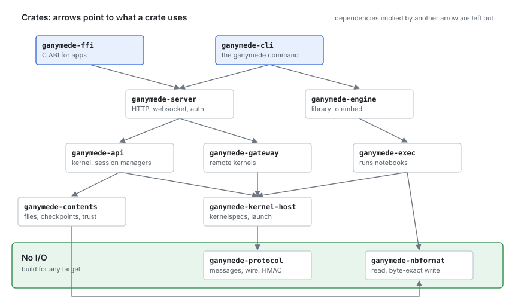

# Architecture

Ganymede replaces one part of the Jupyter stack: the server in the
middle, between the frontends people use and the kernels that run their
code. The interfaces on both sides of that server stay as they are, so
the frontends and kernels on either side don't change. This page shows the
Jupyter architecture first, then where Ganymede sits in it, then how
Ganymede is built inside.

## The Jupyter architecture

Jupyter is three layers joined by two protocols.

- **Frontends** show notebooks and send code to run: JupyterLab and
  Notebook 7 in a browser, the VS Code Jupyter extension, and other
  clients. They never talk to a kernel directly.
- **`jupyter_server`** is the process in the middle. It serves a REST API
  for kernels, sessions (which notebook uses which kernel), contents
  (files and checkpoints), and kernelspecs, and a websocket per kernel
  that carries protocol messages between frontends and the kernel. It
  handles auth, and serves the frontend's static files when the frontend
  is a web page.
- **Kernels** run code in one language. Each is a separate process,
  launched from a *kernelspec*: a `kernel.json` file in a Jupyter data
  directory that gives the command line, display name, language, and
  interrupt mode. ipykernel is the Python kernel; cdp-kernel, IRkernel,
  and many others exist.

The two protocols are what make the layers replaceable:

- Between frontend and server, **HTTP and websockets**: the
  `jupyter_server` REST API, and two websocket framings of protocol
  messages (JSON, and the binary `v1.kernel.websocket.jupyter.org`).
- Between server and kernel, the **Jupyter messaging protocol** over
  **ZeroMQ**: five sockets per kernel (shell for requests, iopub for
  outputs and status broadcast to every client, stdin for `input()`,
  control for interrupt and shutdown, heartbeat for liveness), each message
  signed with HMAC using a key from the kernel's connection file.

Inside `jupyter_server`, the work is split across Python packages:
`jupyter_client` finds kernelspecs, launches kernels, and owns their
sockets; `nbformat` reads, validates, and writes notebook files;
`traitlets` carries configuration; and server extensions plug in more
endpoints. `nbclient` (`jupyter execute`) runs notebooks headless on the
same `jupyter_client`, without the server.

Nothing in the protocols requires Python. The server is where Python comes
in: to run any notebook, even a TypeScript one, you install a Python
environment for `jupyter_server` and `jupyter_client`.

## Where Ganymede sits

Ganymede takes the middle box's place and keeps both of its interfaces:

- **Upward**, it serves the `jupyter_server` REST and websocket API, so
  JupyterLab and VS Code connect to it unchanged. That API is a
  compatibility target: where Ganymede and `jupyter_server` differ, the
  difference is a bug. UIs of Ganymede's own (a TypeScript web UI, or a
  Swift shell with a web view on iPadOS and macOS) are clients of the same
  API, outside the core.
- **Downward**, it launches kernels from the same kernelspecs in the same
  data directories, and speaks the same messaging protocol over ZeroMQ. A
  kernel can't tell Ganymede from `jupyter_server`.

What changes is everything inside the box. It is Rust, one binary or one
library, with no Python environment behind it. Python is still welcome as
a kernel: install ipykernel and its kernelspec, and Ganymede runs it like
any other.

The headless executor moves inside too. `ganymede execute` produces the
notebook `jupyter execute` would, from the same library the server is
built on.

| Jupyter | Ganymede | Notes |
|---|---|---|
| Messaging protocol, wire format | `ganymede-protocol` | Unknown content fields pass through, so kernel extras reach clients. |
| `jupyter_client` | `ganymede-kernel-host` | Kernelspecs, launch, the startup handshake, interrupt, shutdown, heartbeat. |
| `nbformat` | `ganymede-nbformat` | The writer's output is byte-identical to Python's, so saves don't produce diffs. |
| `nbclient` | `ganymede-exec` | The same outputs, `display_id` updates, timings, and error handling. |
| Contents manager | `ganymede-contents` | Atomic writes, modification-time conflict checks, checkpoints. |
| Kernel and session managers | `ganymede-api` | Independent of HTTP, so an in-app bridge can call it too. |
| tornado handlers, auth | `ganymede-server` | axum routes, token auth, origin checks, both websocket framings, JupyterLab's page and `/lab/api/*`. |
| `jupyter` CLI | `ganymede` | `kernelspec`, `run`, `console`, `execute`, `kernel`, `serve`. |
| traitlets config | TOML config file | One file plus command-line flags. |
| Server extensions | none | Not compatible by design: they are Python. |

## Inside Ganymede

The crates are layered so that each profile takes only what it needs.
Lower crates know nothing of the ones above them, and the two at the
bottom do no I/O, so they build for any target.

| Crate | What it is |
|---|---|
| `ganymede-cli` | The `ganymede` binary. |
| `ganymede-ffi` | A C ABI (`include/ganymede.h`) that runs the server on loopback inside an app and returns its URL. A static library; `scripts/build-xcframework.sh` packages it for the Mac and iPad app. See [Embedding](embedding.md#the-server-in-an-app-from-c). |
| `ganymede-server` | The HTTP and websocket server. |
| `ganymede-engine` | The library to embed: find kernelspecs, start or attach to kernels, execute with streaming output, run notebooks. See [Embedding](embedding.md). |
| `ganymede-api` | Kernel and session managers, response models, the per-client bridge, idle culling. No HTTP. Contents path validation confines kernel working directories to the root. |
| `ganymede-gateway` | Kernels on another Jupyter server, as `jupyter_server`'s gateway client: kernelspecs and lifecycle over its REST API, channels over its websocket. The server uses it for `gateway_url`. |
| `ganymede-terminals` | Terminals for `/api/terminals`: the user's shell in a pseudo-terminal (`portable-pty`), shared by any number of clients. None on iOS or wasm. |
| `ganymede-lsp` | Language servers for `/lsp/*`: the servers listed in the config file, one process each, started for the first client and relayed to every client, as `jupyter-lsp` does. None on iOS or wasm. |
| `ganymede-exec` | Runs a notebook with nbclient's semantics. |
| `ganymede-contents` | The contents model over a filesystem. |
| `ganymede-kernel-host` | Kernelspec discovery; the `KernelTransport` seam (ZeroMQ, in-process); provisioners (subprocess, attach to a running kernel); the per-kernel session state machine. |
| `ganymede-protocol` | Message types, the ZeroMQ multipart frame layout with HMAC, connection files, the websocket codecs. |
| `ganymede-nbformat` | nbformat 4.5 reading and writing. |

Outside the Rust core, and outside this repository, the TypeScript for UIs
that render in a web view lives in
[tlockney/ganymede-ui](https://github.com/tlockney/ganymede-ui): its
`packages/client` has protocol types, websocket codecs, a
`ServerConnection` with injectable `fetch` and `WebSocket`, a REST client,
and renderer and widget seams. How the app itself is built, including the
Mac and iPad app around this server, is on ganymede-ui's
[architecture](ganymede-ui/architecture.md) page.

### Seams

Each seam is a Rust trait that the server, the engine, or an app
embedding them can fill differently.

| Seam | What it abstracts | Built | Not built |
|---|---|---|---|
| `KernelTransport` | A stream of channel messages to and from one kernel | ZeroMQ; an in-process channel (the fake kernel); a websocket to a gateway | |
| `Provisioner` | How a kernel comes to exist | A subprocess from a kernelspec; attaching to a running kernel's connection file; a remote kernel through a gateway | A kernel inside the app's own process |
| `TransportFactory` | How a launched kernel gets its transport | ZeroMQ from its connection info; the gateway's websocket | An app's own, for an in-process kernel (the seam allows it: `LaunchedKernel.connection` is `None`) |
| `KernelspecSource` | Which kernels can be launched | The Jupyter data dirs plus `--kernelspec-root`, which is how conda and venv kernels are found without the host knowing what a venv is; a fixed list (`StaticKernelspecs`); a gateway's list | An environment scanner, as VS Code has |
| `Contents` | Files, directories, checkpoints | The local filesystem, with atomic writes and mtime and hash checks; on the iPad, any folder the app can open | Reloading files changed on disk; passing through to a remote host |
| Auth | Who may call the API | A token, traded for a login cookie | `tailscale serve` identity headers; OIDC or a JupyterHub contract |
| Document | The live notebook model | The file, read and written per request | Reload on external change; a `yrs` CRDT for live multi-client sessions |

The server uses kernelspec dirs, subprocesses and ZMQ unless an app
embedding it passes its own `KernelspecSource`, `Provisioner` and
`TransportFactory` in `serve::Startup`; its `subprocess` and `zmq`
features can then be turned off.

Where the ecosystem already has a seam, Ganymede matches it rather than
inventing one. Remote kernels use the protocol of `jupyter_server`'s
gateway client. ganymede-ui reaches every backend through
`@jupyterlab/services`' `ServiceManager`, the seam JupyterLite uses for
its in-browser server; its own seams are on its
[architecture](ganymede-ui/architecture.md) page. The apps were first
planned around a message bridge in place of HTTP. Running the ordinary
server on loopback inside the app, through `ganymede-ffi`, turned out
simpler, so the web view connects as a browser would.

### One rule: the host knows no language

Every language-specific fact comes from the kernel: its kernelspec
(`language`, `metadata`), its `kernel_info_reply` (`language_info`, extra
fields), and the MIME types on its outputs. No code in the host crates depends on
a kernel's language; outside tests, `python` appears there only where
Python's output defines a file format (nbformat's float layout, the
trust signature), in PyPI's names (where `ganymede lab install` gets
JupyterLab), and in comments. The test suite runs the same
scenarios against cdp-kernel and ipykernel, and both must pass.

### Running a cell

Inside Ganymede, `ganymede-server` decodes the websocket frame,
`ganymede-api` notes the client's session so replies find their way
back, and `ganymede-kernel-host` sends the message on the kernel's shell
socket. Every client of the kernel sees iopub, which is how a second tab
shows the same outputs. Only the client that asked gets the reply. The
request is complete when the reply and the matching `idle` have both
arrived; they come on different sockets, in either order.

If the cell calls `input()`, the kernel sends an `input_request` on stdin
to the client that ran the cell, which answers with an `input_reply`.

### Kernel lifecycle

- **Start.** The host allocates ports, writes a connection file, and
  launches the kernelspec's command. It then sends `kernel_info_request`
  on shell and control until both answer and iopub has delivered a
  message. This handshake exists because ZeroMQ's PUB/SUB drops messages
  published before the subscriber connects. A kernel with an XPUB iopub
  socket (ipykernel 7, JEP 65) sends `iopub_welcome` when the
  subscription arrives, which counts as that message, so one request on
  each channel is enough. The welcome is not passed on to clients.
- **Interrupt.** A signal to the process group, or an `interrupt_request`
  on control, whichever the kernelspec's `interrupt_mode` says.
- **Restart and shutdown.** `shutdown_request` on control, a grace period,
  then the process is killed. Restart launches the same kernelspec again
  under the same kernel id.
- **Crash.** A kernel that exits with nothing asking it to is restarted
  under the same id, as `jupyter_server`'s restarter does; after
  `kernel_restart_limit` crashes in a row it is left dead
  ([Kernel crashes](reference.md#kernel-crashes)). Unreleased.
- **Idle culling.** With `--cull-idle-secs`, kernels idle that long with
  no clients are shut down.

### Saving a notebook

![Saving a notebook. The client sends PUT /api/contents with the ETag it read as If-Match, or last_modified in the body. Ganymede reads the file on disk: if the ETag differs it answers 412, and if the file is more than 500 ms newer than last_modified it answers 409, writing nothing. Otherwise it validates the notebook, writes a temporary file and renames it over the old one, signs the notebook in the notary if every code cell is trusted, and creates the first checkpoint if there is none. It answers 200 or 201 with the model and its ETag. Further checkpoints come from POST to the checkpoints endpoint.](images/architecture/save.svg)

A save is one `PUT /api/contents` request with the whole notebook. A
client that sends the `ETag` it read (as `If-Match`) or the
`last_modified` it was given gets 412 or 409, and nothing is written,
when the file changed on disk since; that is how an edit from another
device isn't overwritten. Otherwise the file is replaced atomically, so
a sync or a crash never sees half a notebook, and signed when every code
cell is trusted.

## Where it runs

The same crates, in four setups:

- **Workstation or server.** `ganymede serve` or `ganymede lab` as a
  process: kernel processes over ZeroMQ, files on disk, token auth. Any
  Jupyter frontend connects. `--gateway-url` sends kernels to another
  server instead.
- **Mac app.** The server runs inside the app through `ganymede-ffi` and
  serves ganymede-ui to a `WKWebView` on loopback. Kernels are the Mac's
  kernelspecs, or a kernel server set in the app.
- **iPad app.** The same app built for iOS, which doesn't let an app
  launch processes. Ganymede serves notebooks from a folder the app can
  open; cdp-kernel runs in a Worker in the web view, or kernels come from
  a kernel server through the gateway.
- **Any browser, no server.** ganymede-ui alone, with notebooks in
  IndexedDB and kernels in Workers. Ganymede isn't involved.

Python appears in none of them except as a kernelspec someone installed.
[Ganymede's app](app.md) covers the last three from a user's side. A
native kernel inside the iPad app's process, so it can run more than the
web view allows, is next on the [roadmap](roadmap.md).

## Fitting the Jupyter ecosystem

In order of value per unit of work:

1. **Kernel compatibility.** Protocol 5.x over ZMQ plus the kernelspec
   convention. Every existing kernel works: cdp-kernel, ipykernel, IRkernel,
   IJulia, evcxr, Deno, xeus. This is the core and is non-negotiable.
2. **File compatibility.** nbformat 4.5 with faithful round-trip. Notebooks
   interchange with git, GitHub rendering, nbviewer, nbconvert run elsewhere,
   and every other client. Core.
3. **Tooling conventions.** Jupyter data dirs, runtime dir and connection
   file naming, `JUPYTER_*` environment variables. Cheap, and it means
   `jupyter console --existing`, kernel installers, and environment tools
   all keep working around the host.
4. **Client compatibility.** The `jupyter_server` REST API and websocket
   subprotocols. JupyterLab, VS Code, and other API clients connect
   ([Other Jupyter clients](clients.md) has which); Notebook 7's pages
   aren't served. Medium cost; server and desktop profiles only.
5. **Output and widget compatibility.** The standard MIME types, comms,
   the `jupyter.widget` protocol. [anywidget](https://github.com/manzt/anywidget)-only is small; full ipywidgets
   is a dependency on the standard JS manager, taken only in profiles
   that expect Python kernels.
6. **Debugger.** DAP over the control channel, a DAP client in the UI.
   cdp-kernel and ipykernel both support it.
7. **Extensions.** Prebuilt JupyterLab frontend extensions load as they
   do in JupyterLab. Server extensions, which are Python, are not
   compatible, by design.

Items 1 to 3 are what make "might also run Python" free: a Python kernel
is just another kernelspec, and ipywidgets is just another widget manager
module.

### Tested versions

"Compatible" means compatible with these versions, which CI pins in
[`ci.yml`](../.github/workflows/ci.yml) and bumps in one pull request.
A weekly scheduled run repeats the end-to-end jobs with the latest
release of each, so a new upstream version that breaks something shows
up within a week.

| Target | Tested against | Rule |
| --- | --- | --- |
| `jupyter_server` REST and websocket API | `jupyter_server` 2.21.1, run side by side in the e2e suite | A difference is a bug. |
| Kernel protocol | 5.x; Ganymede's own messages say 5.5. ipykernel 7.4.0 and cdp-kernel 0.7.1 in the e2e suite | A difference is a bug. |
| nbformat | 4.5, against Python's `nbformat` through `jupyter execute` (nbclient 0.11.0) | Byte-for-byte saves. Version 3 is upgraded on read. |
| JupyterLab | 4.6.4, the `ganymede lab install` default, driven in Chromium | Other 4.x releases should work and are not tested. |
| VS Code Jupyter extension | Its remote-server requests, replayed with `@jupyterlab/services` 7.5 | VS Code itself is not run in CI. |

A difference from these that isn't listed in [Known gaps](known-gaps.md)
is a bug; please [report it](https://github.com/tlockney/ganymede/issues).

## Further reading

- [Replacing Python](python-free.md): each place the reference stack
  assumes Python, and what Ganymede does instead.
- [Protocol and kernel host](protocol.md): what each component has to get
  right, and what is usually missed.
- [User interfaces](ui.md): what any notebook UI needs, and the UI options.
- [Ganymede's app](app.md): ganymede-ui in a browser and on the Mac and
  iPad.
- [Development log](notes.md): findings from each step, including what
  JupyterLab and VS Code call and what broke.
