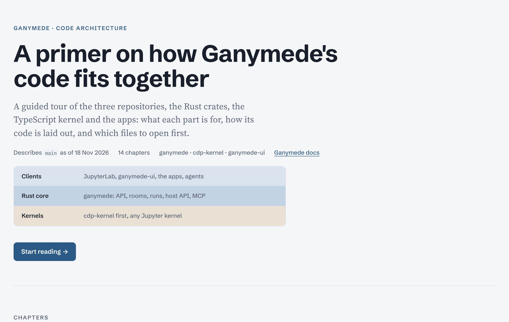

# The book: a code primer

The book is a guided tour of Ganymede's code, written for someone who
wants to read or talk about the code with a sense of where everything
sits. It covers the three repositories (ganymede, cdp-kernel and
ganymede-ui) in fourteen chapters: the Rust crates from the protocol up
to the server, rooms, notebooks as programs, agents, the TypeScript
kernel, the web app and the Apple apps, and how it is all built and
tested. Each chapter says what a part is for, how its code is laid out,
and which files to open first.

It is a separate page from these docs, with its own layout, one chapter
at a time:

**[Read the book](https://ganymede-server.com/book/)**

The book is rebuilt by hand, not on every change, so it describes `main`
as of the date on its opening page. File names and line counts drift;
where the book and a module's header comment disagree, trust the header.
