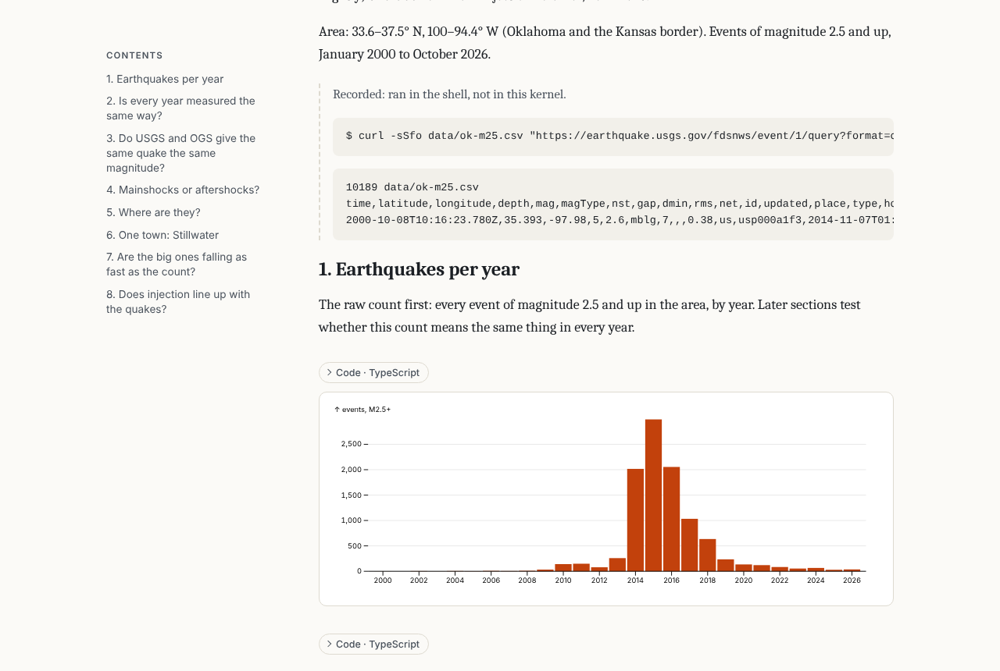

# Agents over MCP

`ganymede mcp` gives a coding agent (Claude Code, Codex, Cursor, or any
other MCP client) tools to open, edit and run notebooks. It is meant for
journaling: the agent records an analysis in a notebook as it works,
code with its output and notes on what each step found, instead of
writing one up at the end. It needs no Python.

## Set up

Add it as a stdio MCP server. For Claude Code:

```sh
claude mcp add ganymede -- ganymede mcp
```

Other clients take the same command (`ganymede mcp`) in their MCP
settings. Paths in the tools are relative to the server's root.

`ganymede mcp` connects to a server in this order:

1. `--server URL` (with `--token` or `JUPYTER_TOKEN`).
2. A running `ganymede serve --mcp` whose root holds the current
   directory (or `--root-dir`), found by its
   [server info file](reference.md#server-info-file). Edits go through
   the server's document rooms, so they show live in JupyterLab (with
   `jupyter-collaboration`) or ganymede-ui while the agent works.
3. Otherwise, a server of its own in the same process, on a loopback
   port with a random token, rooted at the current directory. It stops,
   saving open notebooks, when the agent closes the connection.

Start a shared server with:

```sh
ganymede serve --mcp
```

`--mcp` (config key `mcp_enabled`) serves the same tools over
streamable HTTP at `/mcp`, behind the token, for clients that connect to
a URL instead of starting a command.

## The ganymede-journal plugin for Claude Code

`ganymede-journal` packs the journaling mode into one Claude Code
plugin: the `ganymede mcp` server, a skill with the conventions, a
reviewer agent, and hooks that keep the record honest. Install it from
this repository's marketplace:

```text
/plugin marketplace add tlockney/ganymede
/plugin install ganymede-journal@ganymede
```

Then ask for an analysis and say "keep a journal", or start it by name
with `/ganymede-journal:journal`. The plugin runs `ganymede`, so it must
be on your `PATH`, and its hooks run with `node`.

| Part | What it does |
| --- | --- |
| MCP server `ganymede` | `ganymede mcp`, found or started as [above](#set-up). |
| Skill `journal` | The conventions: a title and goal, one question per section, scratch probes, recorded steps, revising findings in place, reading a person's cells, looking at charts, showing results to the user with snapshots, finishing with run-all and a summary. Its `typescript.md` covers cdp-kernel's display API, Polars and Observable Plot. |
| Agent `journal-reviewer` | Reads the notebook cold, re-runs it, looks at its charts, and lists what a stranger couldn't follow or reproduce. It doesn't edit. |
| Hook `SessionStart` | Says whether a server is running for the directory, its kernels, and the journal open in a resumed session. |
| Hook `UserPromptSubmit` | Reads the open journal with the agent's [read mark](#changes-by-others) and adds what a person or another agent changed as context. |
| Hook `PostToolUse` | Follows the agent's notebook tools (the open notebook, its mark, edits since the last clean run-all). Records a Bash command that ends in `# journal` as a recorded cell, with up to 2,000 characters of its output. |
| Hook `Stop` | Once per round of edits, stops the agent from ending its turn while the journal has edits since its last clean `notebook_run_all`, and asks it to run it or say it is only pausing. |

The hooks reach the server with `ganymede mcp call` (below), so they
find the same server the agent uses: a running `ganymede serve --mcp`,
or the server the agent's `ganymede mcp` started. They keep a small
state file per Claude Code session in the plugin's data directory, and
stay silent when anything fails. Settings, as environment variables:

| Variable | Effect |
| --- | --- |
| `GANYMEDE_JOURNAL_RECORD` | `marked` (default): record Bash commands ending in `# journal`. `all`: every Bash command. `off`: none. |
| `GANYMEDE_JOURNAL_STOP` | `off` turns the `Stop` check off. |
| `GANYMEDE_BIN` | The `ganymede` binary, when it isn't on `PATH`. |

> [!NOTE]
> **Unreleased.** Available only from a build of `main` (HEAD), not in
> the latest release.

The agent can look at any chart with [`cell_snapshot`](#snapshots),
which the skill tells it to do. For images in every `cell_run` reply as
well, start the server with images on:
`ganymede serve --mcp` with `mcp_images = true` in its config, or change
the plugin's server to `ganymede mcp --images` (which always starts a
server of its own, so a person can't watch live).

## Calling a tool from a script

`ganymede mcp call TOOL [ARGS]` calls one tool and prints its text, for
scripts and agent hooks. `ARGS` is a JSON object:

```sh
ganymede mcp call notebook_read '{"path": "journal/flake.ipynb", "since": "3f2a9c0d1b7e4a65"}'
```

It uses `--server`, else a running `ganymede serve --mcp` whose root
holds the current directory (or `--root-dir`), else the server an
agent's `ganymede mcp` started for itself there, which it announces in
`ganymede-mcp-<pid>.json` in the Jupyter runtime dir while it runs. It
starts no server: with none it fails. It exits 1 when the tool reports
an error, after printing the message. `--client NAME` sets the name
recorded in cells' provenance.

`cell_add` takes a `mark`: a read mark to move past the new cell, so a
hook that adds a cell for the agent (as the plugin's Bash hook does)
isn't reported to the agent as someone else's edit.

## Tools

| Tool | Does |
| --- | --- |
| `notebook_open` | Open a notebook, creating it (and its directories) when missing, with an optional title cell; start or join its kernel. Later calls may leave out `path`. |
| `notebook_read` | The notebook as text: cells with ids, sources and outputs, then a read mark. With `since: <mark>`, only what others changed since that read (see [Changes by others](#changes-by-others)). A notebook in nbformat 4.4 or older has no cell ids on disk; the server makes them up when it opens the notebook, and they stay the same while the MCP session lasts. A session ends after an hour without a request, or when the server stops; after that, read the notebook again for new ids. `ganymede mcp` starts a new session by itself. A new session has no notebook open either, so open or read the notebook again, with its `path`, before calls that leave `path` out. |
| `cell_run` | Run code and return its outputs. Recorded as a new code cell by default; `record: false` runs it as scratch work that leaves nothing in the notebook but shares the kernel's state. `keep_outputs: false` records the code but leaves its outputs out (see [Outputs](#outputs)). |
| `cell_add` | Add a Markdown note; `mode: recorded` records a step that ran outside the kernel, such as a shell command. |
| `cell_edit` | Replace a cell's source, keeping the replaced text in the cell's history; `run: true` runs it after, with `keep_outputs` as `cell_run` (see [Outputs](#outputs)). |
| `cell_clear_outputs` | Clear a code cell's outputs and keep them out of the notebook when it runs again; `keep: true` undoes it (see [Outputs](#outputs)). |
| `cell_delete`, `cell_move` | Delete a cell, or move it after another. |
| `kernel_control` | Interrupt, restart, or shut down the kernel. |
| `notebook_run_all` | Restart the kernel and run every code cell in order. |
| `kernelspecs_list`, `notebooks_list` | The kernels available, and the notebooks in a directory. |
| `cell_snapshot` | Cells as Markdown to show a person: code, images saved as files, tables, text (see [Snapshots](#snapshots)). |
| `notebooks_search` | Cells across notebooks that contain every word of a query (see [Search](#search)). |
| `notebook_publish` | The notebook as one self-contained HTML page, saved under the root (see [Publishing a notebook](#publishing-a-notebook)). |

Each notebook is also a `notebook://<path>` resource, and the `journal`
prompt gives the agent conventions for keeping the record.

`cell_run` waits up to `timeout` seconds (600 by default). A recorded
cell that runs longer keeps running, and its outputs keep arriving in
the notebook. A scratch run that runs longer is interrupted, since its
outputs go nowhere and later runs on the shared kernel would wait
behind it. A scratch run that times out before the kernel started it
(queued behind a recorded cell still running, or a cell run from
JupyterLab) interrupts nothing, so that other run isn't stopped; the
reply says the code runs when the kernel is free.

Cells run through the server, as the
[execute endpoint](rooms.md#running-cells-into-a-room) runs
them: outputs go into the document as they arrive, and a person watching
the notebook sees them live.

## Outputs

> [!NOTE]
> **Unreleased.** Available only from a build of `main` (HEAD), not in
> the latest release.

The notebook keeps each recorded cell's outputs: a journal records what a
run produced, not only the code. The server signs the notebook when it
saves it (see [Trust](rooms.md#trust)), so it opens trusted and its
HTML, JavaScript and SVG outputs render in full in ganymede-ui and
JupyterLab.

Some outputs don't belong in the file: a dump too large to keep, or
values too private to share. `cell_run` and `cell_edit` with
`keep_outputs: false`, or `cell_clear_outputs` after the fact, keep the
cell's code and leave its outputs out. The agent still gets them in the
reply. The cell's `metadata.ganymede.outputs` is `"dropped"`, and later
runs through these tools (`cell_edit` with `run`, `notebook_run_all`)
leave their outputs out too; a person running the cell in a frontend
gets them back. Outputs reach the notebook while the cell runs and are
cleared when it finishes, so a long run can be saved with them in
between: keep credentials out of outputs altogether, or look at them
with `record: false`. A cell still running when the call times out
writes its outputs to the notebook when it finishes; the reply says so,
and `cell_clear_outputs` clears them then.

## Snapshots

> [!NOTE]
> **Unreleased.** Available only from a build of `main` (HEAD), not in
> the latest release.

`cell_snapshot(ids)` returns cells as Markdown an agent can put in its
reply to a person, without running anything:

- the code, in a fence tagged with the notebook's language (leave it out
  with `code: false`)
- each image output saved as a file and linked with ``: PNG,
  JPEG, GIF and WebP as they are, an SVG drawn as a PNG as described in
  [What the agent sees](#what-the-agent-sees)
- an HTML table (pandas, Polars) as a Markdown table, cut to `max_rows`
  rows (20 by default), with extra header rows such as Polars' dtypes
  left out; Markdown output as it is, or as text when it is cut at
  4,000 characters
- a Markdown cell as it is, with images it attaches saved and its
  `attachment:` links pointed at them
- other output as plain text, without terminal colors, and a progress
  bar as its last frame; an error as its name and message

The images also come back as MCP image content, whether or not the server
sends images, so an agent can look at a chart before describing it. Files
are named `<notebook>-<cell id>-<n>-<hash>.<ext>` (with characters other
than letters, digits, `-` and `_` made `_`, and the cell id kept to ASCII), so a later snapshot
of a re-run cell doesn't replace an earlier one, and go to `snapshots` in
the outputs directory (readable only by you), or with `dir` to a directory
under the server root, such as `journal/snapshots`, through the contents
API. Links to output images put the path in angle brackets and encode
`#`, `?` and `%`, so the path's characters don't break the Markdown. A
Markdown cell's `attachment:` links are percent-encoded instead (a space
becomes `%20`), so they also work in ``; decode the path before
opening the file. `dir` isn't allowed in read-only mode.

## Search

> [!NOTE]
> **Unreleased.** Available only from a build of `main` (HEAD), not in
> the latest release.

`notebooks_search` finds what earlier notebooks found, such as other
journals on the same data, before an agent starts a new one:

```sh
ganymede mcp call notebooks_search '{"query": "workday 2019", "dir": "journal"}'
```

A cell matches when it contains every word of `query`, in any case and
order. `dir` (default: the root) is searched with its subdirectories,
skipping hidden ones and checkpoints. Sources are searched; with
`outputs: true`, text outputs too (streams, the text of results and
displays, and errors). `cell_type` keeps only `code`, `markdown` or `raw`
cells, and `limit` (default 20, at most 200) caps the cells returned.

The reply counts the matches, then lists each matching notebook with its
title (its first heading) and each cell with its index, id, type, where
it matched, and a line of context. `notebook_read` reads a hit in full.
A notebook open in a room is read from the room, so edits not yet saved
count; others are read from disk. A directory reached through a
symbolic link is searched once. A search reads at most 2,000
notebooks and says so when it stops early.

## Publishing a notebook

> [!NOTE]
> **Unreleased.** Available only from a build of `main` (HEAD), not in
> the latest release.

`notebook_publish` saves the notebook as one HTML page to read and
share, such as a finished journal:

```sh
ganymede mcp call notebook_publish '{"path": "journal/2026-11-09-oklahoma-quakes.ipynb"}'
```



The page has the notebook's first `# ` heading as its title, a table of
contents from its `## ` headings, Markdown cells as prose, and charts,
images and tables inline. Each code cell's code is folded above its
output (`code: "shown"` shows it, `"hidden"` leaves it out). In a
journal, cells a person wrote are marked, and steps recorded outside the
kernel are set apart. It follows the reader's light or dark setting.

It is one file, so it opens anywhere and can be hosted as it is, for
example as a Claude artifact or on a static site. It holds only the
notebook's content:

- cell sources and outputs, and no metadata beyond the kernel's name and
  who kept the journal: no provenance history, ids or signatures
- the server root's absolute path becomes `.`, the home directory `~`,
  and the token `[token]`, wherever they stand as a whole name (not
  `/home/tommy` for `/home/tom`), each directory as given and resolved
- no network requests: images are embedded, a Markdown image from
  elsewhere becomes a link, and HTML outputs run under a policy that
  loads nothing but their own `data:` images and inline styles
- no script from the notebook: SVG goes in as an image, HTML output in a
  frame that can't run scripts, raw HTML in Markdown as text, and an
  output that needs JavaScript to show (Vega-Lite, widgets) as another
  entry in its bundle or a note that it was left out

The page goes to `published/<name>.html` beside the notebook, or to
`out` (a path under the root ending in `.html`). It replaces an earlier
published page there, but another file only with `overwrite: true`.
`byline` sets the line
under the title (default: today's date). It runs nothing, so run the
notebook first if its outputs may be stale. Not in read-only mode.

The same page comes from `ganymede nb publish NOTEBOOK` (with `--code`,
`--byline` and `-o`; it replaces the home directory and the notebook's
directory) and from `GET /nbconvert/html/{path}`, JupyterLab's **Save and
Export Notebook As > HTML**.

## Changes by others

A person may edit the notebook in JupyterLab or ganymede-ui while the
agent works. `notebook_open` and `notebook_read` end with a read mark:

```text
@@read 3f2a9c0d1b7e4a65
```

`notebook_read` with `since: "3f2a9c0d1b7e4a65"` (and `path`, or the
mark's own notebook when left out) returns only the
cells others added, edited or moved since that read, each as an
`@@cell` block whose head has `"change": ["added"]`, `["edited"]`,
`["moved"]` or more than one, and an `@@deleted {"id": ...}` line per
deleted cell. With no changes it says so. Cell sources and types are
compared, not outputs or metadata. A cell is moved when it left the
longest run of cells that kept their order.

Each MCP connection has one mark per notebook, and it keeps its name.
Reading the notebook moves the mark to what was read, and the
connection's own edits (`cell_add`, `cell_run`, `cell_edit`,
`cell_delete`, `cell_move`) move it too, so they are not reported
back. An edit moves only what it changed (`cell_edit` the source,
`cell_move` the place), and a failed edit moves nothing, so someone
else's change to the same cell is still reported. Reading with a mark
makes it the reading connection's mark for that notebook, replacing
any mark the connection had there: the mark it last read with is the
one its edits move. So after `ganymede mcp` starts a new session the
agent's mark keeps following its edits. Another connection to the same server can read with the mark, as
a hook outside the agent would; that read moves the mark as well, so
the agent isn't told the same change twice.

Marks are kept in the server's memory. After a restart, or once more
than 4,096 marks are in use, a mark may be unknown: the read then says
so and returns the whole notebook with a mark to use next. A mark names
one notebook path, so after a rename the old mark is treated the same
way.

## What the agent sees

Outputs come back as text in nb-cli's `@@cell` / `@@output` format:
Markdown or plain text, HTML tags stripped, without terminal colors,
and tracebacks cut to the last frames. An output over 4,000 characters is
written to a file named by its SHA-256 hash in `ganymede-mcp-outputs`
in the Jupyter runtime dir (readable only by you), and the reply gives
its path. Images are left out unless the agent's
server was started with `--images`, which sends them as MCP image
content. Kernels can't ask for input.

With `--images`, an SVG output (what Observable Plot, Vega-Lite and
most chart libraries draw) that has no PNG or JPEG of its own goes to
the agent as a PNG, white background, at most 1,600 pixels on its
longer side. The notebook keeps the SVG. Text uses the fonts installed
on the server's machine. Images inside the SVG are drawn only from
`data:` URLs; the server reads no files an SVG names. An SVG over 2 MB,
or one that can't be drawn, is left out, as before.

## Provenance

Cells an agent writes carry
`metadata.ganymede.agent = {"by": "<client name>", "mode": "executed" | "recorded" | "note", "at": "<time>"}`,
where the name is the one the MCP client gave when it connected. Scratch
runs leave no cells and run with `store_history: false`, so a kernel
that honours it, as ipykernel and cdp-kernel do, doesn't advance its
execution count. They share the kernel's state: a variable a scratch run
assigns stays defined. Other history is kernel-dependent. With
ipykernel, a scratch result still sets `_`, and `Out[N]`/`_N` for the
next recorded cell's number N, which keeps the scratch value if that
cell has no result. A function a scratch run defines shows as
`Cell In[N]` in tracebacks.

When `cell_edit` changes a cell's source, the source it replaced is kept
in `metadata.ganymede.agent.history`, oldest first, as
`{"source": "<old text>", "by": "<client name>", "at": "<time>"}`: the
replaced text, who replaced it and when. A cell keeps the last 10; an
edit that leaves the source as it was adds none. So a finding the agent
revised in place still shows what it said before, and a UI can show the
revisions. The replaced text is saved in the `.ipynb`: editing a secret
out of a cell with `cell_edit` leaves it in `history` until the metadata
is cleared.

## Options

These apply to a server `ganymede mcp` starts itself, so each makes it
start one even when a shared server is running. For `serve --mcp` they
are config keys.

| Flag | Config key | Effect |
| --- | --- | --- |
| `--read-only` | `mcp_read_only` | Read notebooks only: no edits, no execution. |
| `--no-execute` | `mcp_no_execute` | Edit notebooks but run no code. |
| `--images` | `mcp_images` | Send images in outputs to the model. |
| `--own-server` | | Start a server even when one is running. |
| `--default-kernel` | | The kernelspec new notebooks start. |

## nb-cli

[nb-cli](clients.md#agent-clis) is another way in: a command-line tool
for agents that talks to `ganymede serve` over the Jupyter API. It
fits agents without MCP, or a person who wants the same commands in a
terminal. [Agents with nb-cli](agents.md) sets it up with Claude Code.
The journaling conventions are the same either way; the plugin's
`journal` skill has them.
